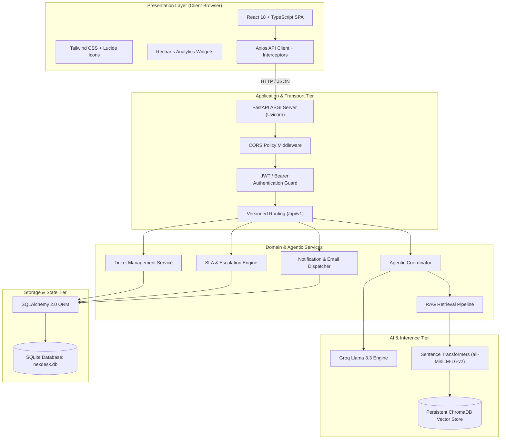
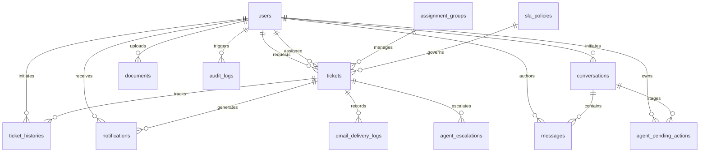
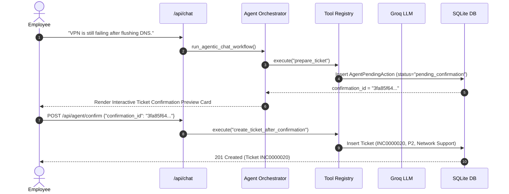

# NexDesk AI

> **Autonomous Agentic IT Service Management (ITSM) Platform**  
> Engineered by **Balaji S** — [GitHub: @Balaji-S2312](https://github.com/Balaji-S2312)

[](https://fastapi.tiangolo.com)
[](https://react.dev)
[](https://www.typescriptlang.org)
[](https://groq.com)
[](https://www.trychroma.com)
[](https://docs.pytest.org)
[](LICENSE)

---

## 1. Project Introduction

**NexDesk AI** is an enterprise-grade IT Service Management (ITSM) platform engineered to streamline employee IT intake, triage, root-cause correlation, and resolution generation through autonomous generative AI agents, vector-grounded retrieval (RAG), and human-in-the-loop workflows.

Combining ultra-fast Groq LLM inference, Sentence Transformers (`all-MiniLM-L6-v2`), persistent ChromaDB vector storage, FastAPI, and React 18, NexDesk AI delivers a production-minded ITSM experience with deterministic ITIL priority calculation, dual-clock SLA tracking (24x7 calendar vs. 9x5 business hours), audit trails, and multi-channel notifications.

---

## 2. Problem Statement

Modern enterprise IT service desks face severe operational bottlenecks:
- **Repetitive Tier-1 Load:** Over 60% of inbound IT inquiries involve common, well-documented issues (VPN authentication failures, password resets, dock monitor flickering, Wi-Fi cert renewals).
- **High Mean Time to Resolution (MTTR):** Unclassified tickets languish in triage queues for hours waiting for manual category assignment, priority assessment, and team routing.
- **Support Staff Fatigue:** IT support technicians spend excessive time performing repetitive information gathering rather than resolving complex infrastructure incidents.
- **SLA Breaches:** Static ticket queues lack real-time predictive alerting, resulting in overlooked high-priority incidents and contractual SLA penalties.

---

## 3. Project Objectives

1. **Grounded Self-Service Resolution:** Provide employees with conversational AI troubleshooting grounded strictly in verified corporate IT documentation, citing exact documents and page numbers.
2. **Deterministic ITIL Triage:** Extract signals from natural language descriptions and calculate priority deterministically via an impact-and-urgency matrix without trusting raw LLM priority outputs.
3. **Controlled Agentic Automation:** Allow the AI assistant to perform structured ITSM actions (knowledge retrieval, classification, priority calculation, routing recommendation, and staging) under strict Human-in-the-Loop (HITL) approval.
4. **Comprehensive Service Level Governance:** Track minute-level response and resolution SLAs with dual clock engines (continuous 24x7 vs. 9x5 business hours with weekend rollover).
5. **Real-Time Telemetry & Transparency:** Maintain full chronological audit logs, multi-tenant ownership boundaries, and interactive command-center analytics.

---

## 4. Key Features

- **Conversational RAG Assistant:** Ingests `.pdf`, `.docx`, and `.txt` runbooks into ChromaDB; extracts token-aware chunks (500 tokens, 75 overlap); generates unit-normalized embeddings; and attributes answers with interactive Knowledge Source cards.
- **AI-Powered Incident Classification:** Analyzes freeform text to recommend titles, subcategories, impact, urgency, and deterministic priority (`P1 Critical`, `P2 High`, `P3 Medium`, `P4 Low`).
- **Autonomous Agentic Workflow:** Features 8 independent backend tools with Human-in-the-Loop staging (`prepare_ticket`) and cryptographic confirmation (`create_ticket_after_confirmation`).
- **Deterministic Priority Matrix:** Enforces ITIL compliance ($3 \times 3$ impact/urgency grid) where clients cannot set priority directly.
- **Dual-Clock SLA Engine:** Computes response and resolution deadlines using either 24x7 continuous calendar time or 9x5 business hours (09:00–17:00 UTC, Mon–Fri, excluding weekends).
- **Incident Lifecycle Management:** Status pipeline (`open → assigned → in_progress ⇄ pending → resolved → closed`) with mandatory resolution notes and field-level history audit logs.
- **Role-Based Access Control (RBAC):** Strict multi-tenant isolation ensuring employees can only view/mutate their own tickets, while administrators access command center telemetry.
- **Centralized Notification Engine:** In-app notification center with real-time unread badges, mark-as-read toggles, and resilient SMTP email logging.
- **Executive Analytics Dashboard:** Interactive Recharts visualizations (ticket trends, category distribution, priority donut, status pipeline, and team workload) with dynamic date filtering (`7d`, `30d`, `90d`, `all`).

---

## 5. Technology Stack

| Layer | Technologies |
|---|---|
| **Frontend UI / SPA** | React 18, TypeScript, Vite, Tailwind CSS, Lucide React, Recharts, Axios, React Router v6 |
| **Backend API** | Python 3.11+, FastAPI (ASGI), Uvicorn, Pydantic V2, SQLAlchemy 2.0 |
| **Generative AI** | Groq API (`llama-3.3-70b-versatile` / `gpt-oss-120b`) |
| **Embeddings & Vector Store** | `sentence-transformers/all-MiniLM-L6-v2` (384-dim), ChromaDB (Cosine Space) |
| **Document Ingestion** | PyMuPDF (`fitz`), `python-docx`, UTF-8 normalizer |
| **Relational Database** | SQLite 3 (`nexdesk.db`) with Foreign Keys enabled |
| **Security & Auth** | Bcrypt (salt & hash), PyJWT (HS256 Bearer tokens), Role-based dependencies |
| **Testing & Quality Assurance** | Pytest, AnyIO, TypeScript Strict Mode, ESLint |

---

## 6. System Architecture



---

## 7. Database Schema

NexDesk AI enforces strict foreign keys (`PRAGMA foreign_keys = ON;`) across 11 relational tables:



For complete field specifications, indexes, and constraints, see [docs/database-design.md](docs/database-design.md).

---

## 8. RAG Pipeline & Document Processing

1. **Ingestion (Admin):** Validates `.pdf`, `.docx`, or `.txt` file format, checks size ($\le 15\text{MB}$), and computes SHA-256 hash to prevent duplicates.
2. **Text Extraction:** Extracts text with page retention via PyMuPDF or python-docx.
3. **Token-Aware Chunking:** Splits text into 500-token chunks with 75-token overlap, preserving sentence and paragraph boundaries.
4. **Vector Embedding:** Computes 384-dimensional dense vectors via singleton `sentence-transformers/all-MiniLM-L6-v2`.
5. **ChromaDB Storage:** Stores vectors and chunk metadata in persistent ChromaDB collection `nexdesk_knowledge`.
6. **Query & Thresholding:** Embeds user inquiries and performs cosine similarity search. Candidates with cosine score $< 0.28$ are pruned as non-relevant distractors.
7. **Citation:** Injects bounded context into Groq LLM and extracts verified `SourceReference` cards citing filename, page number, and excerpts.

For detailed architecture, see [docs/rag-pipeline.md](docs/rag-pipeline.md).

---

## 9. Agentic AI Workflow & Human-in-the-Loop



The system implements 8 controlled tools:
1. `search_knowledge_base`
2. `classify_incident`
3. `recommend_priority`
4. `recommend_assignment_group`
5. `get_ticket_status`
6. `prepare_ticket` (Staging proposal)
7. `create_ticket_after_confirmation` (Persistent execution)
8. `escalate_to_human` (Technician handoff)

For security guardrails and override workflows, see [docs/agent-workflow.md](docs/agent-workflow.md).

---

## 10. ITIL ITSM Processes & SLA Rules

### Priority Calculation Matrix
Priority is strictly derived from **Impact** and **Urgency** and cannot be overridden directly:

| Impact \ Urgency | High | Medium | Low |
|---|---|---|---|
| **High** | **P1 Critical** | **P2 High** | **P3 Medium** |
| **Medium** | **P2 High** | **P3 Medium** | **P4 Low** |
| **Low** | **P3 Medium** | **P4 Low** | **P4 Low** |

### Default SLA Policies
- **P1 Critical:** 15m Response, 4h Resolution, **24x7 Continuous Calendar clock**.
- **P2 High:** 30m Response, 8h Resolution, **24x7 Continuous Calendar clock**.
- **P3 Medium:** 4h Response, 24h Resolution, **9x5 Business Hours clock** (09:00–17:00 M-F UTC, pauses over weekends).
- **P4 Low:** 8h Response, 48h Resolution, **9x5 Business Hours clock**.

For SLA algorithms, see [docs/SLA_MANAGEMENT.md](docs/SLA_MANAGEMENT.md).

---

## 11. API Documentation

Interactive Swagger documentation is automatically hosted at:
- **Swagger UI:** `http://localhost:8000/docs`
- **ReDoc:** `http://localhost:8000/redoc`

Summary of primary endpoint families:
- `/api/auth` — Registration, login, current profile, user inventory.
- `/api/tickets` — Ticket CRUD, search, priority matrix calculation, history timeline.
- `/api/chat` — Generative AI chat, RAG grounding, tool execution.
- `/api/knowledge` — Document upload, semantic search, reprocess, deletion.
- `/api/agent` — Tool listing, ticket staging, confirmation, escalation, admin overrides.
- `/api/analytics` — KPI summary, ticket volume trends, distribution aggregations.
- `/api/sla` — SLA overview, overdue/breached incident telemetry, policy CRUD.
- `/api/notifications` — In-app notification center and email audit logs.

For complete payload schemas, see [docs/api-documentation.md](docs/api-documentation.md).

---

## 12. Installation & Quickstart

### Prerequisites
- **Python:** 3.10 to 3.12
- **Node.js:** v18.0.0 or higher
- **npm:** v9.0.0 or higher
- **Groq API Key:** Obtainable from [console.groq.com](https://console.groq.com)

### 1. Clone Repository
```bash
git clone https://github.com/Balaji-S2312/NexDesk-AI.git
cd NexDesk-AI
```

### 2. Backend Environment Setup
```bash
cd backend
python -m venv .venv

# On Windows:
.venv\Scripts\activate
# On Linux / macOS:
source .venv/bin/activate

pip install -r requirements.txt
cp ../.env.example .env
```

Edit `backend/.env` with your settings:
```env
GROQ_API_KEY=gsk_your_groq_api_key_here
GROQ_MODEL=llama-3.3-70b-versatile
JWT_SECRET=your_super_secret_jwt_key_here
DATABASE_URL=sqlite:///./nexdesk.db
CHROMA_PERSIST_DIRECTORY=./chroma_db
```

### 3. Frontend Setup
```bash
cd ../frontend
npm install
cp .env.example .env
```

---

## 13. Live Cloud Deployment & Local Execution

- **Live Frontend (Vercel):** [https://nexdesk-ai.vercel.app](https://nexdesk-ai.vercel.app)
- **Live Backend API (Render):** [https://nexdesk-backend-z98v.onrender.com/api/health](https://nexdesk-backend-z98v.onrender.com/api/health)
- **Cloud Setup, Constraints & Verification:** See [DEPLOYMENT.md](DEPLOYMENT.md)

### Start Backend Daemon (Local)
```bash
cd backend
.venv\Scripts\activate  # On Windows
uvicorn app.main:app --host 127.0.0.1 --port 8000 --reload
```
*Backend runs on `http://127.0.0.1:8000` (Health check: `/api/health`).*

### Start Frontend Dev Server
```bash
cd frontend
npm run dev -- --host 127.0.0.1 --port 5173
```
*Frontend runs on `http://127.0.0.1:5173`.*

---

## 14. Default Demo Accounts

Upon initial startup, the database is seeded automatically with demo credentials:

| Role | Email | Password |
|---|---|---|
| **System Administrator** | `admin@nexdesk.ai` | `AdminPassword123!` |
| **Demo Employee** | `employee@nexdesk.ai` | `EmployeePassword123!` |

---

## 15. Testing & Quality Assurance

Run the comprehensive automated pytest test suite:
```bash
cd backend
.venv\Scripts\python -m pytest tests -q
```
*Current test suite status: **136 passed, 0 failed**.*

Run frontend linting, TypeScript checks, and production build:
```bash
cd frontend
npm run lint
npm run build
```
*Frontend status: **0 warnings, 0 errors** (`tsc && vite build` clean).*

For full QA telemetry, see [QA_REPORT.md](QA_REPORT.md). For cloud deployment manifests, PostgreSQL migration instructions, and environment setup, see [DEPLOYMENT.md](DEPLOYMENT.md).

---

## 16. Guided Live Demonstration

NexDesk AI includes a step-by-step walkthrough script and 5 sample IT runbooks located in `docs/demo-data/`:
1. `VPN_Troubleshooting_Guide.md`
2. `Password_Reset_Procedure.md`
3. `Laptop_Maintenance_Guide.md`
4. `Email_Configuration_Guide.md`
5. `Network_Connectivity_Guide.md`

Follow the complete script in [docs/demonstration-workflow.md](docs/demonstration-workflow.md) to showcase the end-to-end admin document ingestion $\rightarrow$ employee AI chat $\rightarrow$ failed troubleshooting detection $\rightarrow$ Human-in-the-Loop ticket confirmation $\rightarrow$ admin triage and resolution workflow.

For the interview slide deck, review [docs/presentation.md](docs/presentation.md).

---

## 17. Known Limitations

1. **Local SQLite Concurrency:** SQLite handles standard single-instance concurrent reads and serialized writes. High-throughput horizontal multi-worker clusters should migrate to PostgreSQL.
2. **Business Hours Timezone:** Business hour calculations currently evaluate standard 09:00–17:00 UTC and do not yet feature per-user geographic holiday calendars.
3. **Frontend Chunk Size:** The minified frontend bundle is ~872 kB (237 kB gzipped); future iterations will introduce route-level code splitting (`React.lazy`).

---

## 18. Future Enhancements

- **ChatOps Integration:** Bidirectional incident creation and notifications via Slack and Microsoft Teams webhooks.
- **ITIL Change Management:** Formal Change Advisory Board (CAB) review workflows with risk assessments.
- **Enterprise ITSM Connectors:** Bidirectional synchronization with ServiceNow and Jira Service Management.
- **Multi-Modal Diagnostics:** Image upload support enabling employees to submit screenshots of OS error dialogs for OCR and visual LLM diagnosis.

---

## 19. Author & License

Developed with passion by **Balaji S**:
- **GitHub:** [@Balaji-S2312](https://github.com/Balaji-S2312)
- **Repository:** [https://github.com/Balaji-S2312/NexDesk-AI](https://github.com/Balaji-S2312/NexDesk-AI)

Licensed under the **MIT License**.
