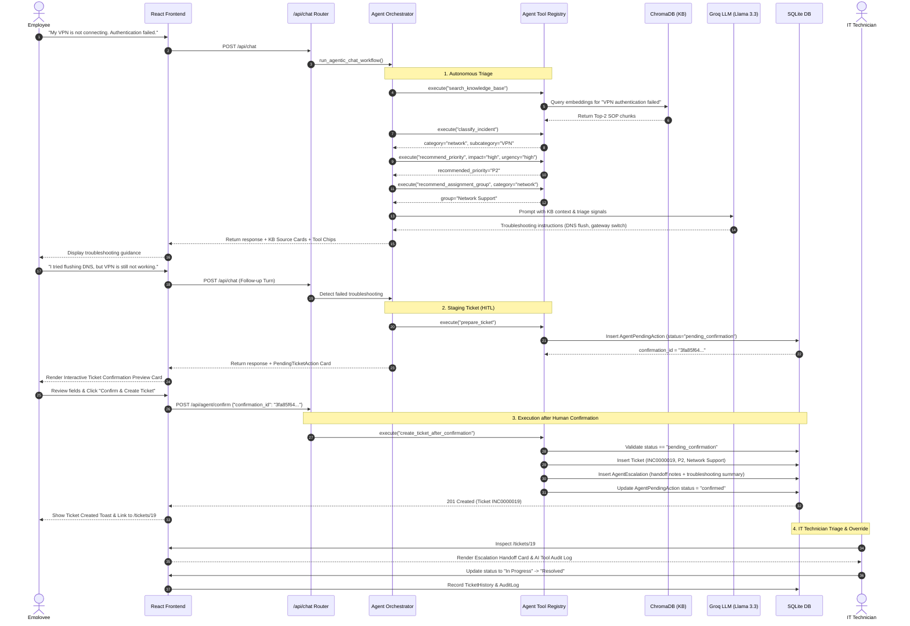

# NexDesk AI – Autonomous Agentic Workflow & Human-in-the-Loop Automation

## 1. Overview & Architectural Philosophy

NexDesk AI incorporates an enterprise **Agentic AI Workflow Engine** that empowers the generative AI assistant to execute authorized backend service management actions autonomously, while enforcing strict **Human-in-the-Loop (HITL)** boundaries, role-based safety checks, and deterministic ITIL business rules.

### Core Principles:
1. **Deterministic Guardrails:** The LLM proposes actions, but the backend Python engine validates user permissions, parameters, and business logic before any persistent state mutation.
2. **Zero Premature Tickets:** The agent never silently creates incident tickets. It prepares a staged proposal (`prepare_ticket`) and requests explicit confirmation.
3. **Idempotency & Duplicate Prevention:** Staged proposals utilize unique cryptographic tokens (`confirmation_id`). Attempting to confirm a ticket twice returns `409 Conflict`.
4. **Transparent Auditability:** Every tool invocation is logged to `agent_tool_logs` with execution time and input/output summaries.

---

## 2. End-to-End Agent Workflow Diagram

---

## 3. The 8 Controlled Agent Tools

| # | Tool Name | Scope & Function | Confirmation Required? |
|---|---|---|:---:|
| 1 | `search_knowledge_base` | Semantic vector lookup against ChromaDB runbooks. | No (Read-Only) |
| 2 | `classify_incident` | Extracts category, subcategory, impact, urgency signals from text. | No (Read-Only) |
| 3 | `recommend_priority` | Deterministically calculates ITIL priority (`P1`–`P4`). | No (Read-Only) |
| 4 | `recommend_assignment_group` | Maps category to target support team (e.g. `Network Support`). | No (Read-Only) |
| 5 | `get_ticket_status` | Looks up status, priority, and SLA target for ticket number `INCxxxxxxx`. | No (Read-Only) |
| 6 | `prepare_ticket` | Stages proposal in `agent_pending_actions` table with `confirmation_id`. | No (Staging Only) |
| 7 | `create_ticket_after_confirmation` | Validates `confirmation_id`, inserts official `Ticket`, and marks proposal confirmed. | **Yes (Mandatory)** |
| 8 | `escalate_to_human` | Creates an `AgentEscalation` record with transcript and troubleshooting summary. | **Yes (Mandatory)** |

---

## 4. Safety Guardrails & Forbidden Actions

1. **Strictly Blocked Auto-Actions:**
   - Tools such as `close_ticket`, `delete_ticket`, `auto_close_ticket`, or `force_create_ticket` are strictly blocked.
   - Any invocation raises `AgentSafetyError` and logs `status="blocked"` in `agent_tool_logs`.
2. **Cross-Tenant & Ownership Protection:**
   - An employee cannot confirm or cancel a proposal owned by another employee (`HTTP 403 Forbidden`).
3. **Double-Submission Prevention:**
   - Once confirmed, the proposal's state transitions to `confirmed`. Subsequent confirmation calls return `HTTP 409 Conflict`.
4. **Administrative Override with Full Audit:**
   - If an AI recommendation is incorrect, administrators can invoke `POST /api/agent/tickets/{id}/override` to adjust category, priority, or assignment group, accompanied by a mandatory `override_reason` logged in `audit_logs`.
