# NexDesk AI – Relational Database Design & Schema Specification

## 1. Database Architecture & Storage Engine

NexDesk AI utilizes **SQLite** for relational persistence, managed via **SQLAlchemy 2.0 ORM** with Alembic-compatible migration patterns. The relational schema is optimized for ACID compliance, transactional integrity, and low-latency queries across the ITSM workflow lifecycle.

### Key Database Conventions:
- **Foreign Key Enforcement:** SQLite foreign keys are explicitly enabled on connection via `PRAGMA foreign_keys = ON;`.
- **Timestamp Precision:** All timestamp columns are stored in **UTC** ISO 8601 format (`datetime.now(timezone.utc)`).
- **Index Optimization:** B-Tree indexes are applied to primary keys, foreign keys, status fields, priorities, categories, and creation timestamps for high-speed filtering and analytics.

---

## 2. Complete Entity-Relationship Diagram

```mermaid
erDiagram
    users ||--o{ tickets : "requests (requester_id)"
    users ||--o{ tickets : "assigned (assignee_id)"
    users ||--o{ conversations : "initiates"
    users ||--o{ messages : "authors"
    users ||--o{ documents : "uploads"
    users ||--o{ ticket_histories : "initiates"
    users ||--o{ audit_logs : "triggers"
    users ||--o{ notifications : "receives"
    users ||--o{ agent_pending_actions : "owns"
    users ||--o{ agent_escalations : "escalates"
    users ||--o{ agent_tool_logs : "invokes"

    assignment_groups ||--o{ tickets : "manages"
    assignment_groups ||--o{ agent_escalations : "receives_handoff"
    sla_policies ||--o{ tickets : "governs"

    tickets ||--o{ conversations : "links_to"
    tickets ||--o{ ticket_histories : "audits"
    tickets ||--o{ notifications : "generates"
    tickets ||--o{ email_delivery_logs : "records_emails"
    tickets ||--o{ agent_pending_actions : "results_from"
    tickets ||--o{ agent_escalations : "references"

    conversations ||--o{ messages : "contains"
    conversations ||--o{ agent_pending_actions : "stages"
    conversations ||--o{ agent_escalations : "summarizes"

    users {
        int id PK
        string name
        string email UK "indexed"
        string password_hash
        string role "employee | admin, indexed"
        datetime created_at "UTC"
        datetime updated_at "UTC"
    }

    tickets {
        int id PK
        string ticket_number UK "INC0000001, indexed"
        string title "indexed"
        text description
        string status "open | assigned | in_progress | pending | resolved | closed"
        string priority "critical | high | medium | low, indexed"
        string category "hardware | software | network | access_management | email | security | other"
        string subcategory
        string impact "high | medium | low"
        string urgency "high | medium | low"
        int requester_id FK "users.id, indexed"
        int assignee_id FK "users.id, nullable, indexed"
        int group_id FK "assignment_groups.id, nullable, indexed"
        int sla_policy_id FK "sla_policies.id, nullable, indexed"
        datetime sla_deadline "UTC, indexed"
        datetime response_deadline "UTC, indexed"
        datetime first_responded_at "UTC, nullable"
        text resolution_notes
        datetime resolved_at "UTC, nullable"
        datetime created_at "UTC, indexed"
        datetime updated_at "UTC"
    }

    assignment_groups {
        int id PK
        string name UK "indexed"
        text description
        datetime created_at "UTC"
    }

    sla_policies {
        int id PK
        string name "indexed"
        string priority "indexed"
        int response_time_minutes
        float response_time_hours
        int resolution_time_hours
        boolean business_hours_only
        string escalation_contact
        datetime created_at "UTC"
    }

    conversations {
        int id PK
        int ticket_id FK "tickets.id, nullable, indexed"
        int user_id FK "users.id, nullable, indexed"
        datetime created_at "UTC"
        datetime updated_at "UTC"
    }

    messages {
        int id PK
        int conversation_id FK "conversations.id, indexed"
        string sender_type "user | agent | system"
        int sender_id FK "users.id, nullable, indexed"
        text content
        datetime created_at "UTC, indexed"
    }

    documents {
        int id PK
        string title "indexed"
        text content
        string filename
        string file_path
        string file_type ".pdf | .docx | .txt"
        int file_size
        string file_hash "SHA-256, indexed"
        string category "indexed"
        string status "pending | processing | completed | failed"
        text error_message
        int page_count
        int chunk_count
        int created_by_id FK "users.id, nullable, indexed"
        datetime created_at "UTC"
        datetime updated_at "UTC"
    }

    ticket_histories {
        int id PK
        int ticket_id FK "tickets.id, indexed"
        int user_id FK "users.id, nullable, indexed"
        string field_changed "status | priority | group_id | ..."
        text old_value
        text new_value
        datetime created_at "UTC, indexed"
    }

    notifications {
        int id PK
        int user_id FK "users.id, indexed"
        int ticket_id FK "tickets.id, nullable, indexed"
        string event_type "ticket_created | status_updated | priority_escalated | assigned | sla_breach | general"
        string title
        text message
        boolean is_read "indexed"
        datetime read_at "nullable"
        string delivery_status "sent | failed"
        datetime created_at "UTC, indexed"
    }

    email_delivery_logs {
        int id PK
        int ticket_id FK "tickets.id, nullable, indexed"
        string recipient_email "indexed"
        string event_type
        string subject
        string status "delivered | failed | skipped"
        text error_message
        datetime sent_at "UTC, indexed"
    }

    agent_pending_actions {
        int id PK
        string confirmation_id UK "uuid4, indexed"
        int conversation_id FK "conversations.id, nullable, indexed"
        int user_id FK "users.id, indexed"
        string proposed_action "create_ticket"
        string title
        text description
        string category_value
        string subcategory
        string impact
        string urgency
        string recommended_priority
        string assignment_group
        text attempted_troubleshooting "JSON string"
        text referenced_kb_docs "JSON string"
        string status "pending_confirmation | confirmed | cancelled | expired"
        datetime expires_at "UTC"
        datetime created_at "UTC"
        datetime updated_at "UTC"
    }

    agent_escalations {
        int id PK
        int ticket_id FK "tickets.id, nullable, indexed"
        int conversation_id FK "conversations.id, nullable, indexed"
        int user_id FK "users.id, indexed"
        text reason
        text conversation_summary
        text attempted_troubleshooting "JSON string"
        text referenced_kb_docs "JSON string"
        int recommended_group_id FK "assignment_groups.id, nullable, indexed"
        datetime created_at "UTC, indexed"
    }

    agent_tool_logs {
        int id PK
        int conversation_id FK "conversations.id, nullable, indexed"
        int user_id FK "users.id, nullable, indexed"
        string tool_name "indexed"
        string status "success | blocked | error, indexed"
        text input_summary
        text output_summary
        float execution_ms
        datetime created_at "UTC, indexed"
    }

    audit_logs {
        int id PK
        int user_id FK "users.id, nullable, indexed"
        string action "indexed"
        string resource_type "indexed"
        string resource_id
        text details
        string ip_address
        datetime created_at "UTC, indexed"
    }
```

---

## 3. Relational Schema Data Dictionary

### 3.1 `tickets` Table
Stores primary incident records.
- `id` (INTEGER, PK): Primary key.
- `ticket_number` (VARCHAR(32), UNIQUE, INDEXED): Human-readable incident identifier (`INC0000001` .. `INC9999999`).
- `title` (VARCHAR(255), INDEXED): Short incident title.
- `description` (TEXT): Full incident issue description.
- `category` (VARCHAR(50), INDEXED): Normalized ITIL category (`hardware`, `software`, `network`, `access_management`, `email`, `security`, `other`).
- `subcategory` (VARCHAR(100)): Specific sub-area (e.g. `VPN`, `Wi-Fi`, `Monitor`).
- `impact` (VARCHAR(20)): Business impact (`high`, `medium`, `low`).
- `urgency` (VARCHAR(20)): Urgency level (`high`, `medium`, `low`).
- `priority` (VARCHAR(20), INDEXED): Deterministic priority derived from impact and urgency (`critical`, `high`, `medium`, `low`).
- `status` (VARCHAR(50), INDEXED): Ticket lifecycle state (`open`, `assigned`, `in_progress`, `pending`, `resolved`, `closed`).
- `requester_id` (INTEGER, FK -> `users.id`): Author employee.
- `group_id` (INTEGER, FK -> `assignment_groups.id`): Assigned support team.
- `sla_deadline` (DATETIME, INDEXED): Resolution SLA timestamp.
- `response_deadline` (DATETIME, INDEXED): Response SLA timestamp.
- `first_responded_at` (DATETIME): Timestamp when an admin/agent first moved status beyond `open` or contacted the employee.
- `resolved_at` (DATETIME): Timestamp when ticket entered `resolved` status.
- `resolution_notes` (TEXT): Mandatory notes documenting how the incident was fixed.

### 3.2 `sla_policies` Table
Defines organizational service level agreements per priority tier.
- `id` (INTEGER, PK): Primary key.
- `priority` (VARCHAR(50), INDEXED): Target priority (`critical`, `high`, `medium`, `low`).
- `response_time_minutes` (INTEGER): Response target in minutes (e.g. 15m for P1, 30m for P2).
- `response_time_hours` (FLOAT): Response target in decimal hours.
- `resolution_time_hours` (INTEGER): Resolution target in hours (4h for P1, 8h for P2, 24h for P3, 48h for P4).
- `business_hours_only` (BOOLEAN): `False` for 24x7 calendar clock (P1/P2); `True` for 9x5 business hours (P3/P4).
- `escalation_contact` (VARCHAR(255)): Distribution email or team on call.

### 3.3 `agent_pending_actions` Table
Stores staged ticket proposals awaiting explicit employee confirmation (Human-in-the-Loop automation).
- `confirmation_id` (VARCHAR(64), UNIQUE, INDEXED): Secure random UUID identifying the proposal.
- `status` (VARCHAR(30)): Staged state (`pending_confirmation`, `confirmed`, `cancelled`, `expired`).
- `attempted_troubleshooting` (TEXT): JSON array of attempted steps.
- `referenced_kb_docs` (TEXT): JSON array of cited document identifiers.

---

## 4. Migrations & Schema Evolution

The application initializes its tables and applies in-place database migrations during startup via `app.database.init_db.init_db()`:
1. `Base.metadata.create_all(bind=engine)`: Idempotently creates missing tables.
2. `migrate_tickets_table()`: Performs schema introspection and executes `ALTER TABLE tickets ADD COLUMN` for modern columns (`response_deadline`, `first_responded_at`, `subcategory`, `impact`, `urgency`, `ticket_number`).
3. `migrate_documents_table()`: In-place column upgrades for file hashes and processing metadata.
4. `migrate_sla_policies_table()`: Upgrades SLA policy definitions with minute-level response metrics and business hour flags.
5. Default Seed Data: Idempotently provisions administrator (`admin@nexdesk.ai`), demo employee (`employee@nexdesk.ai`), standard IT assignment groups, and 4 baseline SLA policies.
