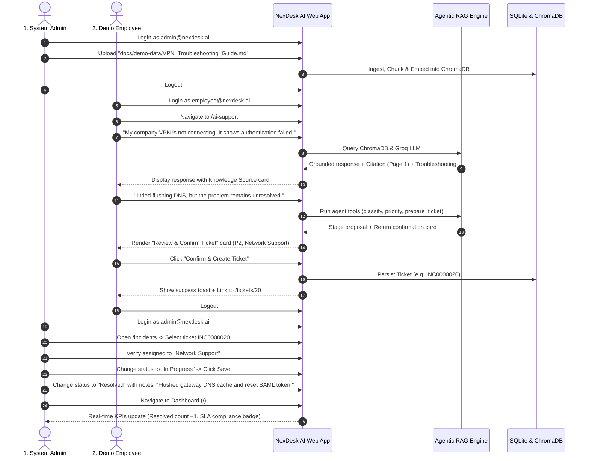

# NexDesk AI – Guided Live Demonstration Workflow Script

This walkthrough demonstrates the complete **End-to-End Employee-to-Administrator Incident Lifecycle** on a live NexDesk AI instance.

---

## 1. Demo Prerequisites & Credentials

| Role | Email | Password | Access Level |
|---|---|---|---|
| **System Administrator** | `admin@nexdesk.ai` | `AdminPassword123!` | Full ITSM Command Center, Knowledge Base Uploads, SLA Management, Group Routing |
| **Demo Employee** | `employee@nexdesk.ai` | `EmployeePassword123!` | Self-Service AI Chat, My Tickets, Notifications, Profile |

- **Frontend URL:** `http://localhost:5173`
- **Backend API:** `http://localhost:8000`
- **Demo Documents Directory:** `docs/demo-data/`

---

## 2. Step-by-Step Demonstration Walkthrough

---

### Step 1: Admin Uploads VPN Troubleshooting Runbook
1. Open `http://localhost:5173/login`.
2. Enter email `admin@nexdesk.ai` and password `AdminPassword123!`.
3. In the sidebar, click **Knowledge Base** (`/knowledge-base`).
4. Click **Upload Document**.
5. Select `docs/demo-data/VPN_Troubleshooting_Guide.md` (or `.pdf` / `.docx`).
6. Set Category to **Network** and Title to **Corporate VPN Troubleshooting Guide**.
7. Click **Upload & Process Document**.
8. Notice the live status changes to **Ready** with processed chunk counters.

---

### Step 2: Employee Inquires About VPN Failure
1. Log out via the profile menu in the upper right.
2. Sign in as the employee: `employee@nexdesk.ai` / `EmployeePassword123!`.
3. Click **AI Assistant** (`/ai-support`).
4. Type the prompt:
   > *"My company VPN is not connecting. It shows authentication failed."*
5. Press **Send**.
6. **Observation:**
   - Animated typing indicator appears: *"Searching Knowledge Base & consulting Groq LLM..."*
   - Response appears, quoting the exact steps from `VPN_Troubleshooting_Guide.md`.
   - An interactive **Knowledge Source Card** appears below the message displaying the source document, page number, and similarity score.
   - Real-time **Agent Tool Badges** show `search_knowledge_base`, `classify_incident`, and `recommend_priority`.

---

### Step 3: Employee Reports Troubleshooting Failed & Confirms Ticket
1. Reply in the same chat:
   > *"I followed the steps to flush DNS and restart, but the problem remains unresolved."*
2. Press **Send**.
3. **Observation:**
   - The AI Assistant recognizes unsuccessful troubleshooting.
   - An interactive **Human-in-the-Loop Ticket Proposal Card** mounts directly in the chat feed:
     - Title: *Corporate VPN authentication failure*
     - Category: *Network* | Subcategory: *VPN*
     - Recommended Priority: *P2 High* (Calculated deterministically)
     - Recommended Assignment Group: *Network Support*
     - Attempted Troubleshooting list populated from conversation history.
4. Click **Confirm & Create Ticket**.
5. The system instantly generates the official incident number (e.g., `INC0000020`).
6. Click the direct link to open the ticket on `/tickets/20`.
7. Notice the **Live Ticket Age** countdown and active **Response SLA** timer.

---

### Step 4: Admin Triage, Status Progression & Resolution
1. Log out and re-authenticate as `admin@nexdesk.ai`.
2. Click **All Incidents** (`/incidents`).
3. Locate the newly created ticket (`INC0000020`).
4. Click to open **Ticket Details** (`/tickets/20`):
   - Review the **AI Escalation & Troubleshooting Handoff** banner displaying the employee's conversation history and attempted steps.
   - Group is already pre-routed to **Network Support**.
5. Change **Status** from `Assigned` to `In Progress` and click **Save Changes**.
   - A green toast confirms: *"Ticket updated: INC0000020 saved."*
   - The **Ticket History Timeline** immediately logs the status update event.
6. Now select **Status: Resolved**.
7. In the **Resolution Notes** textarea, enter:
   > *"Flushed corporate gateway DNS cache on vpn-east.nexdesk.ai and refreshed SAML certificate. Employee verified connection restored."*
8. Click **Save Changes**.
   - Notice the status badge transitions to green `Resolved`.
   - The SLA status displays `Compliant`.

---

### Step 5: Command Center & Real-Time Analytics Update
1. In the sidebar, click **Dashboard** (`/`).
2. Notice the real-time SQLite analytics update without page reload:
   - **Total Tickets** and **Resolved Tickets** increment.
   - **Ticket Trends** AreaChart renders the new resolved data point.
   - **Assignment Group Workload** chart displays Network Support throughput.
   - Date filter buttons (`7 Days`, `30 Days`, `90 Days`, `All Time`) dynamically slice the live SQLite metrics.
