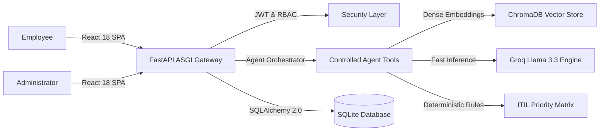

# NexDesk AI – Executive & Technical Presentation
### Next-Generation Agentic IT Service Management (ITSM) Platform

---

## Slide 1: Title & Executive Summary
- **Project Name:** NexDesk AI
- **Tagline:** Enterprise Autonomous IT Service Management & Self-Healing Agent Platform
- **Author & Developer:** Balaji S ([GitHub: @Balaji-S2312](https://github.com/Balaji-S2312))
- **Core Mission:** Eliminate manual Tier-1 IT helpdesk friction by combining high-speed LLM reasoning (Groq Llama 3.3), deterministic ITIL business rules, persistent vector RAG (ChromaDB), and Human-in-the-Loop agentic workflows.

---

## Slide 2: Problem Statement
- **Enterprise Helpdesk Bottleneck:** IT support departments are inundated with repetitive tier-1 inquiries (VPN connection drops, password resets, dock flickering, Wi-Fi cert renewals).
- **High MTTR (Mean Time to Resolution):** Tickets sit in unassigned queues for hours waiting for triage, manual categorization, and routing.
- **Support Fatigue & Inconsistent Triage:** Manual classification results in misrouted tickets, incorrect priority tags, and missed SLA commitments.

---

## Slide 3: Existing ITSM Limitations
1. **Static Legacy Knowledge Bases:** Employees rarely read 40-page Confluence runbooks or static wiki articles; they simply open a blank ticket.
2. **Rule-Based Chatbots Are Rigid:** Traditional keyword-matching helpdesk bots fail on conversational variations and lack context awareness.
3. **Unchecked Generative AI Risks:** Naive LLM chatbots hallucinate corporate policy, fabricate broken links, and lack safety guardrails for system mutation.
4. **Disjointed Tools:** Traditional architectures separate the chat interface from the actual ticketing engine, requiring manual double-entry.

---

## Slide 4: Proposed Solution — NexDesk AI
- **Grounded Self-Service (RAG):** Dynamically retrieves verified runbooks from ChromaDB and cites specific documents and page numbers.
- **Autonomous Agentic Triage:** Automatically analyzes issues, derives deterministic ITIL priority from impact and urgency, and routes to appropriate resolver groups.
- **Human-in-the-Loop Safety:** Staged ticket proposals (`prepare_ticket`) require explicit user confirmation before touching persistent records.
- **Full-Lifecycle ITSM Suite:** Real-time dual-clock SLA engine (24x7 continuous calendar vs. 9x5 business hours), audit trails, notifications, and interactive analytics dashboards.

---

## Slide 5: System Architecture

---

## Slide 6: Technology Stack
- **Frontend:** React 18, TypeScript, Tailwind CSS, Lucide Icons, Recharts, Axios, Vite.
- **Backend Application:** Python 3.11+, FastAPI (ASGI), Uvicorn, Pydantic V2, SQLAlchemy 2.0.
- **Artificial Intelligence & RAG:**
  - LLM Inference: Groq API (`llama-3.3-70b-versatile` / `gpt-oss-120b`).
  - Embedding Model: `sentence-transformers/all-MiniLM-L6-v2` (384-dimensional dense vectors).
  - Vector Database: Persistent ChromaDB with Cosine Distance.
  - Document Parsing: PyMuPDF (`fitz`), python-docx.
- **Database & Security:** SQLite 3 (Foreign Keys enabled), Bcrypt password hashing, PyJWT (HS256).

---

## Slide 7: RAG Implementation Highlights
- **10-Step Document Ingestion Pipeline:** Admins upload `.pdf`, `.docx`, or `.txt`.
- **Token-Aware Chunking:** 500 tokens per chunk with 75-token overlap, preserving 1-indexed document page boundaries.
- **Relevance Gatekeeper:** Cosine thresholding ($\ge 0.28$) prunes noise; answers explicitly admit missing documentation rather than guessing.
- **Zero Hallucination Attribution:** Knowledge source cards cite verified document titles, page numbers, match percentages, and excerpt snippets.

---

## Slide 8: Agentic AI Workflow & Human-in-the-Loop
- **8 Independent Backend Tools:**
  1. `search_knowledge_base`
  2. `classify_incident`
  3. `recommend_priority`
  4. `recommend_assignment_group`
  5. `get_ticket_status`
  6. `prepare_ticket` (Staging)
  7. `create_ticket_after_confirmation` (Persistent Execution)
  8. `escalate_to_human`
- **Safety Invariants:**
  - Zero unconfirmed tickets created.
  - Destructive tools (`auto_close`, `delete`) are blocked and audited.
  - Duplicate confirmation blocked with HTTP 409 Conflict.
  - Admin override UI with mandatory audit log tracking.

---

## Slide 9: Ticket Automation & SLA Management
- **Deterministic Priority Engine:** Priority cannot be set directly; calculated via $3 \times 3$ matrix:
  - $\text{High} \times \text{High} \rightarrow \text{P1 Critical}$ (15m response, 4h resolution, 24x7 clock)
  - $\text{High} \times \text{Medium} / \text{Medium} \times \text{High} \rightarrow \text{P2 High}$ (30m response, 8h resolution, 24x7 clock)
  - $\text{Medium} \times \text{Medium} / \text{Low} \times \text{High} \rightarrow \text{P3 Medium}$ (4h response, 24h resolution, 9x5 business hours)
  - $\text{Low} \times \text{Low} / \text{Low} \times \text{Medium} \rightarrow \text{P4 Low}$ (8h response, 48h resolution, 9x5 business hours)
- **Live Incident Telemetry:** Live ticket age countdowns, near-breach alerts, overdue tracking, and interactive Recharts analytics.

---

## Slide 10: Results & Future Scope
- **Current Verified Results:**
  - 125 backend automated pytest tests passing (100% test success).
  - 46/46 live HTTP integration checks passing on active server.
  - Sub-30ms local API response times; sub-2s Groq LLM inference.
  - Zero TypeScript build or ESLint warnings.
- **Future Roadmap:**
  - Automated Slack / Microsoft Teams Bot webhooks.
  - ITIL Problem & Change Management modules with CAB approval workflows.
  - Multi-tenant enterprise clustering with PostgreSQL and Redis message queues.
  - Bi-directional sync with ServiceNow and Jira Service Management.
